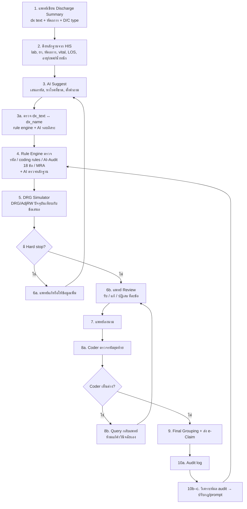

# AI Suggest & Alert → Human Approve: Discharge Summary Flow

ระบบช่วยแพทย์และ coder สรุปเวชระเบียนผู้ป่วยในให้ถูกต้อง ครบถ้วน และมีหลักฐานรองรับ โดย **AI เสนอ, Rule engine ตรวจ, คนตัดสินใจ**

> เอกสารประกอบ: [discharge-summary.md](discharge-summary.md) (แนวทางการสรุปและเกณฑ์ MRA)

---

## 1. ภาพรวม



---

## 2. ขั้นตอนและผู้รับผิดชอบ

`who_do`: **human** = แพทย์/coder/ทีม, **rule engine** = กฎตายตัวและ grouper, **ai** = โมเดลภาษา

| ขั้น                                                                      | who_do                                                 | ทำอะไร                                                                                                                                                                                           | ผลลัพธ์                                     |
| ----------------------------------------------------------------------------- | ------------------------------------------------------ | ------------------------------------------------------------------------------------------------------------------------------------------------------------------------------------------------------ | -------------------------------------------------- |
| 1. เขียน summary                                                         | **human** (แพทย์)                           | พิมพ์ dx text, หัตถการ, D/C status/type ตามปกติ                                                                                                                                     | ข้อความวินิจฉัยและหัตถการ |
| 2. รวบรวมหลักฐาน                                                 | **rule engine**                                  | ดึงข้อมูลจาก HIS: lab (Hb, Cr, Na, K, culture, ABG), ยา/เลือดที่ให้, หัตถการ, เวลา ventilator, วันเวลารับ/จำหน่าย, อายุ/เพศ/น้ำหนัก | ข้อมูลไว้ให้ AI อ้างอิง         |
| 3a. แปลงข้อความเป็นรหัส + ตรวจความสอดคล้อง | **ai** + **rule engine** + **human** | ดูหัวข้อ 4                                                                                                                                                                                     | รหัสที่ผ่านการตรวจ               |
| 3b. หาโรคที่อาจขาด                                              | **ai**                                           | อ่านหลักฐานแล้วชี้โรคร่วมที่อาจยังไม่ได้สรุป เช่น Hb 7 + ให้ PRC แต่ไม่มี anemia                                                            | Suggestion 🔵                                      |
| 3c. ตั้งคำถามกลับ                                                | **ai**                                           | ถามเมื่อคำวินิจฉัยไม่จำเพาะหรือกำกวม เช่น AKI ชนิดไหน, CKD stage อะไร, "CA" ที่ตำแหน่งไหน                                              | คำถามถึงแพทย์                         |
| 4a. ตรวจความถูกต้องของรหัส                              | **rule engine**                                  | รหัสมีจริง, เป็น PDx ได้ (Appendix A2), ตรงเพศ/อายุ, น้ำหนักทารก, คู่ †/*                                                                                    | Hard stop 🔴                                       |
| 4b. ตรวจกฎ coding                                                       | **rule engine**                                  | exclusion/ซ้ำซ้อน, อาการของโรคหลัก, เงื่อนไข AI-Audit 18 ข้อของ สปสช.                                                                                          | Warning 🟠                                         |
| 4c. ตรวจเกณฑ์ MRA                                                    | **rule engine**                                  | ใช้ตัวย่อ, ไม่มีวันเวลาหัตถการ OR, transfer ไม่ระบุ รพ., ไม่มี clinical summary/home med, ไม่ลงนาม                                                   | Hard stop / Warning                                |
| 4d. ตรวจหลักฐาน                                                    | **ai**                                           | ตรวจว่าแต่ละรหัสมีหลักฐานใน chart เช่น sepsis แต่ hemoculture ลบ หรือ pneumonia ไม่มีผล CXR (เสี่ยง over-code)                                    | Warning 🟠                                         |
| 5. DRG simulate                                                               | **rule engine**                                  | grouper คำนวณ DRG/AdjRW ตามรหัสเดิมเทียบกับข้อเสนอ                                                                                                                      | ส่วนต่าง AdjRW และบาท                |
| 6a. แก้ hard stop                                                          | **human** (แพทย์)                           | แก้หรือเพิ่มข้อมูลจนผ่าน                                                                                                                                                       | ผ่านเงื่อนไขบังคับ               |
| 6b. Review ข้อเสนอ                                                     | **human** (แพทย์)                           | รับ/แก้/ปฏิเสธทีละรายการ ตอบคำถาม ถ้าปฏิเสธต้องเลือกเหตุผล                                                                                       | summary ที่แพทย์ยืนยัน               |
| 7. ลงนาม                                                                 | **human** (แพทย์)                           | ลงนามอิเล็กทรอนิกส์ (ชื่อ + เลข ว.)                                                                                                                                         | เข้าเกณฑ์ MRA ข้อ 9                    |
| 8a. ตรวจรหัสสุดท้าย                                            | **human** (coder)                                | ตรวจหลักฐานแล้วยืนยันรหัส                                                                                                                                                     | รหัสพร้อมส่ง                           |
| 8b. Query แพทย์                                                          | **human** (coder → แพทย์)                  | ถ้าเห็นต่างให้ส่งคำถามกลับ ห้ามแก้คำวินิจฉัยเอง                                                                                                          | กลับไปขั้น 6b                            |
| 9a. Final grouping                                                            | **rule engine**                                  | group ครั้งสุดท้ายแล้วตรวจซ้ำทุกกฎ                                                                                                                                         | DRG/AdjRW ที่จะเบิก                       |
| 9b. ส่งเบิก                                                            | **human** กด / **rule engine** ส่ง    | ส่ง e-Claim                                                                                                                                                                                         | ข้อมูลเข้า สปสช.                     |
| 10a. บันทึก audit log                                                   | **rule engine**                                  | เก็บว่า AI เสนออะไร ใครรับหรือปฏิเสธ เหตุผล และเวลา                                                                                                        | หลักฐานไว้ขอทบทวน                 |
| 10b. วิเคราะห์ผล audit                                             | **ai** + **human**                         | AI สรุปรูปแบบที่ถูกตัดหรือถูกปฏิเสธบ่อย แล้วทีมตัดสินใจ                                                                                             | ข้อเสนอปรับปรุง                     |
| 10c. ปรับกฎ                                                             | **human** (ทีมเวชระเบียน/IT)        | อนุมัติและแก้กฎใน rule engine หรือ prompt                                                                                                                                         | ระบบรุ่นใหม่                           |

---

## 3. บทบาทของแต่ละฝ่าย

| who_do                                         | ทำอะไร                                                                                                                                                                                                                                                                                                          | ไม่ทำ                                                                                                                                                | ขั้นที่รับผิดชอบ                         |
| ---------------------------------------------- | --------------------------------------------------------------------------------------------------------------------------------------------------------------------------------------------------------------------------------------------------------------------------------------------------------------------- | --------------------------------------------------------------------------------------------------------------------------------------------------------- | -------------------------------------------------------- |
| **ai**                                   | ตีความข้อความ เสนอรหัส หาโรคที่อาจขาด ตั้งคำถามกลับ ตรวจว่ารหัสสอดคล้องกับข้อความและมีหลักฐานใน chart สรุปรูปแบบความผิดพลาดจากผล audit                                                           | ตัดสินใจเอง ใส่รหัสลงระบบเอง แก้คำวินิจฉัย ตรวจกฎที่เขียนเป็นเงื่อนไขตายตัวได้ | 3a-1, 3a-4, 3b, 3c, 4d, 10b                              |
| **rule engine**                          | ดึงหลักฐานจาก HIS ดึงชื่อรหัสทางการ ตรวจกฎตายตัว (รหัส, เพศ/อายุ, PDx ที่ห้ามใช้, exclusion, AI-Audit 18 ข้อ, MRA) ตรวจ attribute ของ dx_text ↔ dx_name รวมผลการตรวจ คำนวณ DRG/AdjRW บันทึก audit log ส่ง e-Claim | ตีความภาษา เดาเจตนาของแพทย์ ตัดสินแทนคน                                                                              | 2, 3a-2, 3a-3, 3a-5, 4a, 4b, 4c, 5, 9a, 9b (ส่ง), 10a |
| **human: แพทย์**                    | วินิจฉัย เขียน summary แก้ hard stop รับ/แก้/ปฏิเสธข้อเสนอพร้อมเหตุผล ตอบคำถาม ลงนาม                                                                                                                                                                       | ปล่อยให้ AI สรุปแทน                                                                                                                        | 1, 3a-6, 6a, 6b, 7                                       |
| **human: coder**                         | ยืนยันรหัสสุดท้ายจากหลักฐาน ส่งคำถามกลับแพทย์เมื่อเห็นต่าง กดส่งเบิก                                                                                                                                                                                | แก้คำวินิจฉัยของแพทย์เอง                                                                                                          | 3a-6, 8a, 8b, 9b (กด)                                  |
| **human: ทีมเวชระเบียน/IT** | ทบทวนผล audit อนุมัติการเปลี่ยนกฎและ prompt                                                                                                                                                                                                                                              | ให้ AI แก้กฎเอง                                                                                                                                | 10b, 10c                                                 |

**หลักแบ่งงาน:** งานที่ต้องตีความภาษาให้ **ai**, งานที่เขียนเป็นเงื่อนไขตายตัวได้ให้ **rule engine** และงานที่มีผลทางกฎหมายหรือการเงินต้องเป็น **human** เสมอ

---

## 4. ขั้น 3a: ตรวจความสอดคล้องระหว่าง dx_text กับ dx_name

หลักการ: **ถอดรหัสแล้วต้องได้ชื่อโรคเดิมกลับมา** (Standard Coding Guidelines)

| ขั้น                         | who_do                               | ทำอะไร                                                                                                                                                                  | ผลลัพธ์                    |
| -------------------------------- | ------------------------------------ | ----------------------------------------------------------------------------------------------------------------------------------------------------------------------------- | --------------------------------- |
| 3a-1. เสนอรหัส           | **ai**                         | แปลง dx_text เป็นรหัส ICD-10 / ICD-9                                                                                                                              | code ที่เสนอ               |
| 3a-2. ดึงชื่อทางการ | **rule engine**                | ค้น dx_name จาก `icd10_desc` / `icd9_desc` และตรวจว่ารหัสมีจริงและใช้ได้ (`valid`, ไม่ใช่หัวข้อที่มีข้อย่อย) | dx_name ทางการ              |
| 3a-3. ตรวจด้วยกฎ       | **rule engine**                | เทียบ attribute สำคัญระหว่าง dx_text กับ dx_name                                                                                                          | match / conflict ราย attribute |
| 3a-4. ตรวจความหมาย   | **ai** (อิสระจาก 3a-1) | AI รอบใหม่ที่ไม่เห็นเหตุผลของรอบแรก อ่าน dx_text เทียบกับ dx_name แล้วตัดสินระดับ                                  | ระดับ + เหตุผล         |
| 3a-5. ตัดสินผล           | **rule engine**                | รวมผล 3a-3 กับ 3a-4 ถ้าขัดกันให้ยึดผลที่เข้มกว่า                                                                                          | สถานะสุดท้าย          |
| 3a-6. ยืนยัน               | **human** (แพทย์/coder)   | ดู dx_text กับ dx_name เทียบกันแล้วรับหรือแก้                                                                                                      | รหัสที่ยืนยัน        |

### Attribute ที่ rule engine ตรวจ (3a-3)

| Attribute                         | ตัวอย่างคำใน dx_text              | เงื่อนไข                                                            |
| --------------------------------- | --------------------------------------------- | --------------------------------------------------------------------------- |
| ข้าง                          | left, right, bilateral, ซ้าย, ขวา      | ข้างเดียวกัน                                                    |
| ระยะ                          | acute, chronic, acute on chronic              | ไม่ขัดกัน                                                          |
| ชนิด/type                     | type 1, type 2, STEMI, NSTEMI                 | ตรงกัน                                                                |
| ตำแหน่ง/อวัยวะ       | anterior wall, femur neck, stomach            | ตำแหน่งเดียวกัน                                              |
| เชื้อก่อโรค            | Klebsiella, Staph, dengue                     | ตรงกัน หรือ dx_name ไม่ระบุเชื้อ (= หยาบกว่า) |
| ภาวะแทรกซ้อน          | with hemorrhage, with coma, with ketoacidosis | ถ้ามีใน text ต้องมีใน dx_name                                |
| พฤติกรรมโรค            | malignant, benign, secondary, in situ         | ตรงกัน                                                                |
| open/closed                       | open fracture, closed                         | ตรงกัน                                                                |
| การตั้งครรภ์/ทารก | in pregnancy, newborn                         | รหัสต้องอยู่ในหมวด O หรือ P ตามบริบท          |

### ระดับความสอดคล้อง (3a-4 / 3a-5)

| สถานะ                 | ความหมาย                                                                  | ตัวอย่าง                                                       | การทำงานต่อ                                    |
| -------------------------- | --------------------------------------------------------------------------------- | ---------------------------------------------------------------------- | --------------------------------------------------------- |
| ✅ **Exact**         | ความหมายตรงกัน                                                      | "Pneumonia" → J18.9 Pneumonia, unspecified                            | ส่งให้แพทย์ยืนยันตามปกติ          |
| 🔵 **Less specific** | รหัสหยาบกว่า text                                                     | "Lobar pneumonia RLL" → J18.9 (ควรเป็น J18.1)                  | เสนอรหัสที่ละเอียดกว่า              |
| 🟠 **More specific** | รหัสละเอียดเกินที่แพทย์เขียน (เสี่ยง over-code) | "Pneumonia" → J15.0 Klebsiella โดยไม่มีผลเพาะเชื้อ | ต้องถามแพทย์ ห้ามรับอัตโนมัติ |
| 🟠 **Partial**       | ครอบคลุมไม่ครบ หรือควรใช้ combined code/หลายรหัส  | "Gastric ulcer with bleeding" → K25.9 (ขาด hemorrhage)             | เสนอรหัสที่ครอบคลุม                    |
| 🔴 **Mismatch**      | ความหมายต่างกัน                                                    | "Left femoral neck fracture" → รหัส shaft, "Type 1 DM" → E11     | บล็อก ต้องแก้                                 |
| ❓ **Ambiguous**     | dx_text กำกวมจนเลือกรหัสเดียวไม่ได้                    | "CA", "UGIB", "AKI"                                                    | ถามกลับแพทย์ (3c)                             |

### หน้าจอยืนยัน (3a-6)

```
dx_text  : Acute STEMI anterior wall
code     : I21.0
dx_name  : Acute transmural myocardial infarction of anterior wall
สถานะ    : ✅ Exact
หลักฐาน  : EKG ST elevation V1–V4 (2026-10-29 08:12), Troponin 12.4
[รับ] [แก้] [ปฏิเสธ + เหตุผล]
```

---

## 5. ระดับของ Alert

| ระดับ                                              | ความหมาย                                                                                      | ตัวอย่าง                                                                                                                                                                                                                                                                                                             |
| ------------------------------------------------------- | ----------------------------------------------------------------------------------------------------- | ---------------------------------------------------------------------------------------------------------------------------------------------------------------------------------------------------------------------------------------------------------------------------------------------------------------------------- |
| 🔴 **Hard stop** (ส่งต่อไม่ได้)       | จัดกลุ่มไม่ได้หรือผิดแน่นอน                                                | ไม่มี PDx, PDx เป็นรหัสห้ามใช้ (A2), ทารก < 28 วันไม่มีน้ำหนัก, PDx ขัดกับเพศหรืออายุ, dx_text ↔ dx_name mismatch, ไม่มีลายมือชื่อ, transfer แต่ไม่ระบุ รพ.ปลายทาง                                                                |
| 🟠 **Warning** (ต้องตอบก่อนลงนาม) | เสี่ยงถูกตัดตอน audit หรือ under-code                                              | D62 แต่ไม่มีการให้เลือด, J96.0 แต่ไม่มี ventilator, R18 แต่ไม่ได้เจาะท้อง, CKD ไม่ระบุ stage, AKI ไม่ระบุชนิด, sepsis แต่ hemoculture ลบ, บาดเจ็บแต่ไม่มี external cause, รหัสละเอียดเกินกว่าที่แพทย์เขียน |
| 🔵 **Suggestion** (ไม่บังคับ)            | อาจมีโรคร่วมที่ยังไม่ได้สรุป หรือรหัสละเอียดขึ้นได้ | Hb 7 + ให้ PRC แต่ไม่ได้สรุป anemia, Cr ขึ้น 0.3 ใน 48 ชม. แต่ไม่ได้สรุป AKI, ใส่ท่อแต่ไม่มีรหัส 96.7x                                                                                                                                                                |

### เงื่อนไข AI-Audit ของ สปสช. (ปีงบ 2567) ที่ใช้ใน 4b

1. Acute blood loss (D62) แต่ไม่มีรหัสการให้เลือด
2. Anemia/leukopenia/thrombocytopenia ร่วมกับโรคที่เป็นสาเหตุของ pancytopenia
3. Hypoglycemia ร่วมกับโรคที่เป็นสาเหตุ (sepsis, hepatic failure, adrenal insufficiency)
4. Metabolic acidosis (E87.2) ร่วมกับ CKD, sepsis หรือ diarrhea
5. Seizure (R56.8) ร่วมกับ alcohol withdrawal
6. Respiratory failure (J96.0) แต่ไม่มีรหัส ventilator (ไม่ได้เสียชีวิตหรือ refer)
7. P28.5 ร่วมกับ RDS of newborn
8. K92.1/K92.2 ร่วมกับรหัสโรคทางเดินอาหารส่วนต้นที่ระบุ "with hemorrhage" แล้ว
9. K92.2/K62.5 ร่วมกับ I84.1
10. N18.9 ร่วมกับ diabetic nephropathy
11. N17- on top CKD stage 5
12. UTI (N10/N11/N39.0) ร่วมกับ N20
13. N11/N20 ร่วมกับ N13
14. R39.2 หรือ I95.1 ร่วมกับ AGE
15. R18 แต่ไม่ได้ทำ abdominocentesis
16. SIRS without organ failure (R65.0/R65.2/R65.9)
17. IVUS (00.2-) ใน รพช. ระดับ F
18. PCI/PTCA (00.66) ที่ไม่ระบุจำนวน vessel

---

## 6. หลักการที่ต้องยึด

1. **AI เสนอได้ แต่คนเป็นผู้ตัดสิน** ทุกรหัสต้องมีแพทย์หรือ coder กดยืนยัน ห้ามระบบใส่รหัสเอง
2. **ต้องมีหลักฐานทุกข้อเสนอ** AI ต้องชี้ว่าใช้ข้อมูลส่วนไหนใน chart ถ้าไม่มีหลักฐานให้เป็นคำถามเท่านั้น
3. **ห้ามแก้คำวินิจฉัยของแพทย์** coder และ AI ทำได้แค่ query
4. **ถ้ากฎใดเขียนเป็นเงื่อนไขตายตัวได้ ให้อยู่ใน rule engine ไม่ให้ AI ทำ** เพื่อให้ผลตรวจซ้ำได้และอธิบายต่อ auditor ได้
5. **AI ตรวจงานตัวเองไม่ได้** การตรวจความสอดคล้อง (3a-4) ต้องเป็นรอบอิสระ
6. **แจ้งทั้งสองทิศทาง** เตือนทั้งสรุปขาด (under-code) และสรุปเกินหลักฐาน (over-code) เพื่อไม่ให้ระบบกลายเป็นเครื่องเพิ่ม RW ซึ่งเสี่ยงความผิดตามระเบียบคณะกรรมการหลักประกันสุขภาพแห่งชาติ พ.ศ. 2566 ข้อ 12
7. **Audit trail ครบ** เก็บ dx_text, รหัสที่เสนอ, dx_name, สถานะ, เหตุผลของ AI ทุกรอบ, การตัดสินใจของคน และเวลา
8. **ข้อมูลผู้ป่วยไม่ออกนอกระบบโดยไม่ได้รับอนุญาต** ถ้าใช้ LLM ภายนอกต้องตัดข้อมูลระบุตัวตนก่อนหรือใช้โมเดลภายใน และต้องสอดคล้องกับ PDPA

---

## 7. ตัวชี้วัด

| ตัวชี้วัด                                                                                  | ใช้ดูอะไร                                                                                                                            |
| --------------------------------------------------------------------------------------------------- | --------------------------------------------------------------------------------------------------------------------------------------------- |
| % summary ที่ผ่านโดยไม่มี hard stop                                                  | คุณภาพการสรุปครั้งแรก                                                                                                    |
| เวลาตั้งแต่จำหน่ายถึงลงนามและส่งเบิก                            | ความเร็ว                                                                                                                              |
| % ข้อเสนอที่แพทย์รับ แยกตามสถานะ 3a                                    | ความแม่นของ AI (ถ้าต่ำแปลว่า AI เสนอมั่ว)                                                                      |
| สัดส่วน Mismatch / More specific                                                             | ความเสี่ยง over-code จาก AI                                                                                                      |
| คะแนน MRA ส่วน Discharge Summary                                                           | คุณภาพเวชระเบียน                                                                                                              |
| จำนวนรหัสที่ AI-Audit ของ สปสช. ตัด และ AdjRW ที่ถูกเรียกคืน | ผลจาก audit ภายนอก (ควรลดลง)                                                                                                |
| CMI และ AdjRW ต่อ admission                                                                   | ต้องดูคู่กับอัตราถูกตัด ถ้า CMI ขึ้นพร้อมกับถูกตัดมากขึ้น แปลว่ากำลัง over-code |

---

## 8. สถานะของระบบในโปรเจกต์นี้

| ส่วน                                                                                | สถานะ                                                                                           |
| --------------------------------------------------------------------------------------- | ---------------------------------------------------------------------------------------------------- |
| DRG simulator (ขั้น 5, 9a)                                                          | ✅ มีแล้ว: `lib/tdrg/` (ตรงกับ TGrp6305 99.9%), `/api/drg/calculate`                 |
| ตารางรหัสและชื่อโรค (3a-2)                                           | ✅ มีแล้ว: `icd10_desc`, `icd9_desc`, `c63i10`, `c63proc` ใน PGlite, `/api/libs/*` |
| ตรวจรหัส/เพศ/อายุ/PDx ที่ห้ามใช้ (4a)                          | 🟡 ตรรกะมีอยู่ใน grouper แล้ว ต้องแยกออกมาเป็น alert                |
| กฎ AI-Audit 18 ข้อ และ MRA (4b, 4c)                                             | ⬜ ต้องสร้าง                                                                                |
| ตัวดึง attribute สำหรับ 3a-3                                                | ⬜ ต้องสร้าง                                                                                |
| เชื่อม HIS (ขั้น 2)                                                           | ⬜ ต้องสร้าง                                                                                |
| AI suggest / ตรวจความหมาย / ตรวจหลักฐาน (3a-1, 3a-4, 3b, 3c, 4d) | ⬜ ต้องสร้าง                                                                                |
| หน้าจอ approve + audit log (6, 8, 10a)                                            | ⬜ ต้องสร้าง                                                                                |

**ลำดับที่แนะนำ:** เริ่มจาก rule engine (4a–4c) + DRG simulator ก่อน เพราะทำได้เร็ว ผลแน่นอน และเห็นผลต่อ AdjRW ทันที จากนั้นจึงเพิ่ม AI suggest และขั้น 3a
